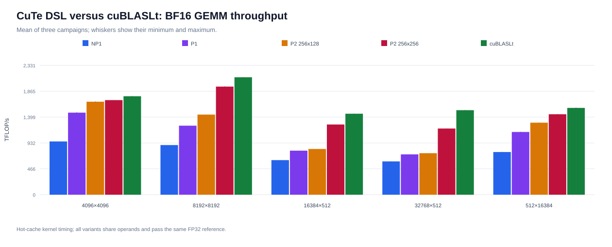
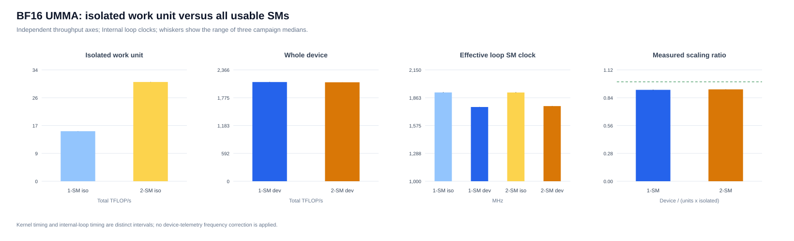
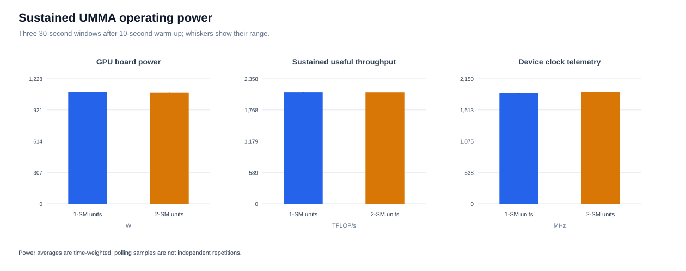
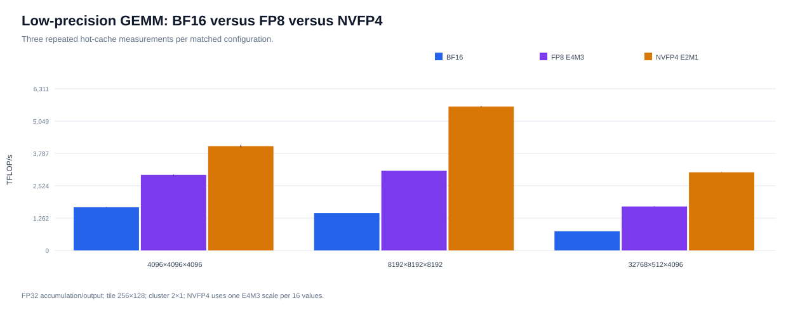

# NVIDIA B300 GEMM Microbenchmarks

Five experiments connect global-to-shared transfers, isolated BF16 UMMA,
whole-device scaling, GEMM organization and input precision on one NVIDIA B300.
The question is which measured instruction and data-supply limits explain the
shape-dependent gap between pinned CuTe DSL configurations and cuBLASLt.

## Validated acquisition

The current results come from **study-20261021T202311Z**, acquired on 21 October
2026 after a passing B300 pilot. The acquisition source is commit
[`5f6902c`](https://github.com/Antoniomv7/gb300-microbench/tree/5f6902c536a2d35183d2d2cbe0ec2561364f4884).
Publishing these summaries does not change that measured source identity.
All nine CSVs and seven SVGs were regenerated byte-for-byte from the raw archive.

- [Raw study archive](data/study-20261021T202311Z.tar.gz)
- [SHA-256](data/study-20261021T202311Z.tar.gz.sha256)
- [Complete execution log](study-20261021T202311Z.log)
- [Measurement protocol](docs/review_protocol.md) and [provenance](docs/provenance.md)
- [Earlier study and interpretation](docs/historical_results.md), kept separate

GPU: B300 SXM6 AC, 148 SMs, UUID `GPU-40e00845-d89c-1393-2c32-a2dca3ee9442`,
ECC enabled, unlocked clocks, 1100 W power limit. `VERSIONS.env` pins the
container digest, CUDA 13.1 target `sm_103a`, CUTLASS source and packages.
The manifests record driver 610.43.02, NCU 2025.4, PyTorch 2.10.0+cu130,
CuTe DSL 4.6.1 and the complete software/power-limit fingerprint.

## Results

| Experiment | Main observation |
|---|---|
| I: global-to-shared copy | LDGSTS has the higher mean in 8/9 pairs; maxima are 7.024 and 6.961 TB/s of logical useful bytes for LDGSTS and TMA. |
| II: isolated UMMA | The best one-SM sequence reaches 8098.100 FLOP/cycle/SM; the two-SM unit reaches 1.9837 times its total work/cycle. |
| III: scaling | One-SM and two-SM units reach 2108.574 and 2102.744 TFLOP/s over 148 SMs, retaining 91.91% and 92.42% of isolated per-SM event-based rates. |
| III: loop clocks | Effective loop clocks fall from about 1917 MHz to 1767/1776 MHz; normalized work/cycle ratios stay at 0.99996/0.99954. Frequency is the dominant consistent explanation of the loss, without an exact decomposition of kernel-event time. |
| III: sustained power | Three 30 s windows per method after 10 s warm-up give 1095.55 and 1091.37 W, near the configured limit. |
| IV: tile intervention | P2 256×256 improves all five shapes over P2 256×128, by 1.017–1.594×; it reaches 78.29–96.05% of cuBLASLt. |
| IV: traffic | Both P2 tiles exactly match the tile-supply TMA model in all three profiled shapes; the wider tile reads two-thirds as many TMA bytes. DRAM locality remains a separate effect. |
| IV/V: timing | Paired ordinary-host/graph mean-time ratios span 1.00002–1.01941 in IV and 0.99256–1.02325 in V. They do not explain the main kernel gap. |
| V: precision | With a fixed 256×128 CuTe tile, FP8 provides 1.75–2.28× BF16 throughput and NVFP4 2.41–4.06×, reaching 5.615 PFLOP/s. cuBLASLt reaches 7.504 PFLOP/s NVFP4. |



| Shape (M×N×K) | P2 256×128 TFLOP/s | P2 256×256 TFLOP/s | cuBLASLt TFLOP/s | Wide P2 / cuBLASLt |
|---|---:|---:|---:|---:|
4096³ | 1676.7 | 1705.1 | 1775.3 | 96.05% |
8192³ | 1444.1 | 1949.1 | 2117.6 | 92.04% |
16384×512×4096 | 824.6 | 1264.8 | 1459.9 | 86.64% |
32768×512×4096 | 748.2 | 1192.5 | 1523.2 | 78.29% |
512×16384×4096 | 1298.5 | 1450.5 | 1564.3 | 92.72% |

For BF16, one input supply to each joint output tile predicts
`Q_TMA = 2MNK(1/tile_m + 1/tile_n)` bytes for exact tile multiples.
The 256×128 and 256×256 variants produce 1.5/1 GiB at 4096³ and the tall
shape, and 12/8 GiB at 8192³, exactly matching the calibrated counter.
The cuBLASLt counters remain compatible with inferred joint tiles 256×256
for square cases and 512×128 for the tall case. Its undocumented names do
not uniquely specify an implementation.

The wider tile also changes resources and scheduling. In the tall case,
it requests less TMA than cuBLASLt (1 versus 1.25 GiB) yet remains slower
and reads more DRAM. At 4096³ its DRAM reads rise despite the TMA reduction.
The measured improvement supports the geometric supply explanation while
constraining a claim that traffic alone determines time.





## Measurement and validation

- I–III: 30 launches per configuration, reduced to a median within each of
  three campaigns. IV: 5 shapes × 5 candidates per campaign. V: 3 shapes ×
  3 formats × 2 implementations × 3 repetitions. There are six sustained
  power windows and nine hot-cache GEMM profiles.
- Numerical checks, allocations, compilation and profiling stay outside
  timed samples. V checks identical operand bytes including NVFP4 scales,
  numerical outputs, a negative validation control and stable accepted
  cuBLASLt algorithms.
- II–III save cycles and global timestamps over the same loop, including
  timestamp brackets and timed SM IDs. III keeps internal-loop and
  whole-kernel event intervals separate. Device telemetry supplies context.
- IV–V use common graph-replay timing and a paired ordinary-host/event
  diagnostic on the same workspace and explicit non-default stream,
  with 5 warm-up and 20 measured launches each. The NVFP4 stream helper is
  scoped to the current stream; original example source files stay pinned.
- Sustained power identifies average and instantaneous GPU-board fields,
  integrates archived traces over exact boundaries and rejects gaps or
  unstable windows. Polling at 50 ms is not 50 ms sensor bandwidth.
- Analysis enforces complete configuration grids, timer arithmetic, one
  GPU/source/environment, finished acquisitions and excluded pilot data.
  Three observations support descriptive statistics. Whiskers show their
  observed minimum and maximum, not confidence intervals. CSVs also save SD/CV.

Experiment I uses 256 B-wide TMA boxes without swizzle, 2–32 KiB per box;
it is not a general LDGSTS-versus-TMA claim for GEMM. The nominal bridge
`8192 FLOP/cycle/SM × 148 × 1.855799 GHz ≈ 2.25 PFLOP/s` uses an implied
nominal clock, distinct from the measured effective loop clocks.

## Regenerate without a GPU

```bash
cd data
sha256sum -c study-20261021T202311Z.tar.gz.sha256
cd ..
mkdir -p runs/reviewed-archive
tar -xzf data/study-20261021T202311Z.tar.gz -C runs/reviewed-archive
python3 analysis/analyze.py \
  --study runs/reviewed-archive/runs/study-20261021T202311Z \
  --output runs/reviewed-regenerated
```

Use a fresh output directory. The 16 CSV/SVG products reproduce exactly;
the analysis metadata records the new output's time and input paths.
The PDF figures are print exports using the same observations and range
convention; the manuscript includes their plotting source.

## Repeat on a B300

Follow the [fixed protocol](docs/review_protocol.md) from acquisition commit
`5f6902c`. Build with `make image`, choose an idle B300 using
`BLACKWELL_GPU_INDEX`, and run `make pilot` before
`make final-study PILOT=runs/pilot-<UTC>`. A new commit/environment requires
a new pilot. The final target runs the complete population and analysis;
it never overwrites an existing run directory or automatically publishes results.
Run strict shell blocks in a child `bash` process so a failing command
does not close the interactive terminal.

## Scope and files

The findings describe one GPU, dynamic clocks, deterministic small-integer
operands, hot-cache reuse and a limited configuration grid. First-supported
heuristics and selected CuTe configurations do not establish library ceilings.
IV and V BF16 baselines are separate matched acquisitions under a common
timing policy; their numbers need not coincide exactly.

`memory_paths/`, `umma_throughput/`, `gemm_comparison/` and
`precision_comparison/` implement the experiments. `scripts/` handles
acquisition, `analysis/` the summaries, and `tests/` CPU checks. `results/`
contains the reviewed population; `data/` its raw archive and checksum.
`evidence/sass/` remains explicitly historical September disassembly,
not a disassembly of the October instrumented binaries. Old tags retain
their original targets; this acquisition is identified by source commit,
dataset ID and SHA-256 throughout.

BSD 3-Clause; see [LICENSE](LICENSE).
